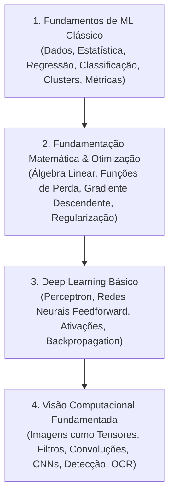

# Trilha Matemática e a Ponte para Visão Computacional

## O Diagnóstico Central
A estatística descritiva e os testes de hipóteses do Capítulo 2 são essenciais, mas insuficientes por si sós para sustentar a compreensão profunda dos algoritmos de Machine Learning clássico, e menos ainda a transição para Deep Learning e Visão Computacional.

A matemática não pode parecer uma coleção desconectada de fórmulas no início do livro, nem ser omitida quando os modelos forem apresentados.

---

## 1. Os Cinco Pilares Fundamentais

```text
1. Álgebra e Notação        -> Variáveis, funções, somatórios, notação vetorial/matricial.
2. Álgebra Linear           -> Vetores, produto escalar, matrizes, normas, projeções, autovalores.
3. Probabilidade/Estatística-> Variáveis aleatórias, esperança, variância, covariância, Bayes.
4. Cálculo Diferencial      -> Derivadas, regra da cadeia, derivadas parciais, vetor gradiente.
5. Otimização no ML         -> Funções de custo, gradiente descendente, regularização (L1/L2).
```

### Abordagem Híbrida Recomendada:
- **Matemática Contextualizada (no corpo do capítulo):** Quando apresentar Regressão Linear, introduzir a notação vetorial $\hat{y} = \mathbf{w}^T \mathbf{x} + b$, a função de perda (MSE) e como o gradiente descendente ajusta os pesos passo a passo.
- **Apêndices / Capítulos de Referência Rápida:** Sessões dedicadas a consolidar o ferramental matemático formal, permitindo ao leitor recorrer a elas conforme a necessidade sem interromper o ritmo narrativo do capítulo prático.

---

## 2. A Escada Conceitual até a Visão Computacional

A transição do ML clássico para imagens deve seguir uma progressão lógica, onde cada estágio é consequência direta do anterior:



### Detalhamento dos Níveis:

1. **Fundamentos de ML Clássico (Onde o livro está hoje):**
   - Dados, estatística, separação geométrica, métricas corretas.
2. **Fundamentação Matemática e Algoritmos:**
   - Formalizar o aprendizado como um problema de otimização: minimizar $J(\theta)$.
   - Introduzir o gradiente descendente e a intuição geométrica da descida pela superfície de erro.
3. **Deep Learning:**
   - Do neurônio artificial (regressão logística generalizada) ao Perceptron Multicamadas (MLP).
   - Funções de ativação (ReLU, Sigmoid, Softmax) e a regra da cadeia na retropropagação (backpropagation).
4. **Visão Computacional:**
   - Imagens como matrizes/tensores de pixels ($H \times W \times C$).
   - Convolução como produto escalar local deslizante (extração de bordas e texturas).
   - Arquiteturas CNN fundamentadas matematicamente.
   - Aplicações práticas autorais: classificação de imagens, detecção de objetos e OCR para extração de texto em telas.
